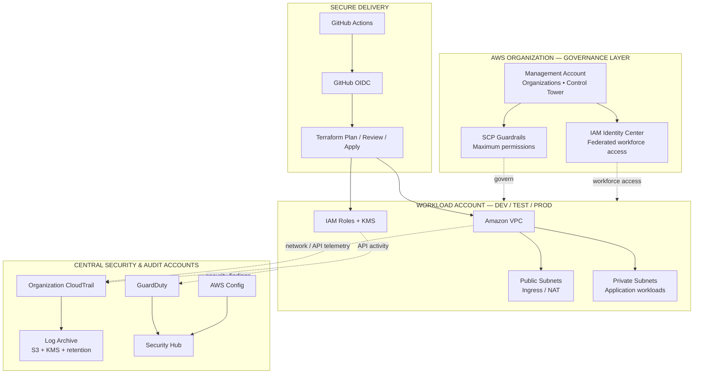
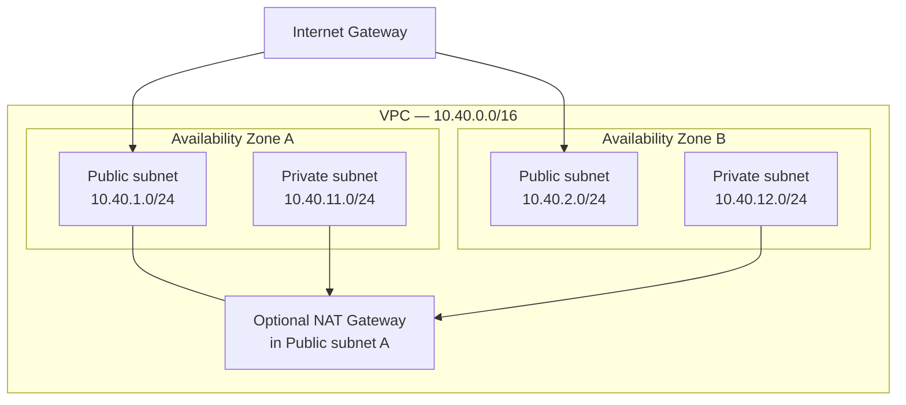

# AWS Enterprise Cloud Governance & Security Platform

<p align="center">
  
  
  
  
  
</p>

> A practical AWS platform engineering lab covering repeatable network infrastructure, identity federation, governance guardrails, security visibility, CI quality gates and production operations.

**Audience:** Senior DevOps / DevSecOps Engineers, Cloud Platform Engineers, Cloud Security Engineers and SREs.

## Enterprise architecture

The diagram below is rendered natively by GitHub Mermaid. It does not depend on SVG preview support.



**Important:** This is a target-state reference architecture, not a screenshot of deployed AWS resources. The Terraform currently implements a single-account VPC foundation. Organization-level services are documented patterns and examples, not deployed by the current root module.

Read the [enterprise account model](docs/architecture/enterprise-account-model.md) and [architecture guide](docs/architecture/README.md).

## What is implemented

| Capability | Current repository scope |
|---|---|
| Network foundation | Terraform VPC, two-AZ public/private subnet tiers, route tables and Internet Gateway |
| Egress | Optional single NAT Gateway (disabled by default; billable) |
| Network visibility | Optional VPC Flow Logs to CloudWatch Logs with configurable retention (disabled by default) |
| CI | GitHub Actions: Terraform fmt/init/validate, TFLint, Checkov and example JSON validation |
| Security examples | SCP guardrail samples and GitHub OIDC trust template |
| Operations | Runbooks for audit, access, incident response, drift and recovery |
| Interview prep | Senior Q&A and 20 detailed production incident scenarios, plus system-design cases |

## Network topology — Terraform lab



NAT is disabled by default. When enabled, this lab uses one NAT Gateway in the first public subnet; this is a cost-saving lab topology, not a highly available production egress design.

## Quick start — local validation only

Prerequisites: Terraform 1.6+, AWS CLI v2 and Git.

```bash
git clone https://github.com/haqueamir70-coder/aws-enterprise-cloud-governance-security-platform.git
cd aws-enterprise-cloud-governance-security-platform
terraform -chdir=terraform fmt -check -recursive
terraform -chdir=terraform init -backend=false
terraform -chdir=terraform validate
```

These commands do not create AWS resources. GitHub Actions runs the same baseline checks plus lint and static security scanning.

For a real sandbox deployment, first read the [deployment guide](docs/deployment/README.md), verify the AWS identity and estimate cost:

```bash
aws sts get-caller-identity
terraform -chdir=terraform plan -out=tfplan
terraform -chdir=terraform show tfplan
# Apply only after reviewing and approving the plan:
terraform -chdir=terraform apply tfplan
```

## Repository map

```text
.github/workflows/      CI quality gates
docs/architecture/      Account model, trust boundaries and flows
docs/assets/            Original SVG assets (optional download)
docs/deployment/        Safe deployment and teardown
docs/interview/         Senior Q&A and production scenarios
docs/runbooks/          Operational procedures
docs/security/          Control catalogue and validation matrix
policies/               SCP and OIDC examples
terraform/              Single-account network foundation
```

## Scope boundaries — read before deployment

- **Implemented:** the Terraform root provisions a single-account VPC foundation. Optional NAT and Flow Logs are off by default.
- **Reference design / examples:** Organizations, Control Tower, centralized organization CloudTrail, delegated security administration, Security Hub and GuardDuty are documented patterns; they are not deployed by this Terraform root.
- **No credentials in Git:** use short-lived credentials and OIDC. Never commit access keys, Terraform state, plan files or secrets.
- **Cost:** NAT, CloudWatch log ingestion/retention, Config evaluations, Security Hub and GuardDuty can incur charges. Review current pricing and destroy lab resources after testing.
- **SCP caution:** SCPs set maximum permissions; they do not grant permissions. Test in a non-production OU and preserve break-glass recovery.

See [delivery status](docs/DELIVERY-STATUS.md) for implementation evidence and CI status.

## Senior interview preparation

Start with the [interview index](docs/interview/README.md), then practice the [advanced production scenarios](docs/interview/advanced-production-scenarios.md). Each incident answer follows containment, evidence, diagnosis, recovery and prevention. Do not memorize paragraphs; explain decisions and trade-offs.

## Contributing

Use small pull requests, include test output where practical, explain security impact and update documentation. See [CONTRIBUTING.md](CONTRIBUTING.md).

## License

MIT. See [LICENSE](LICENSE).
