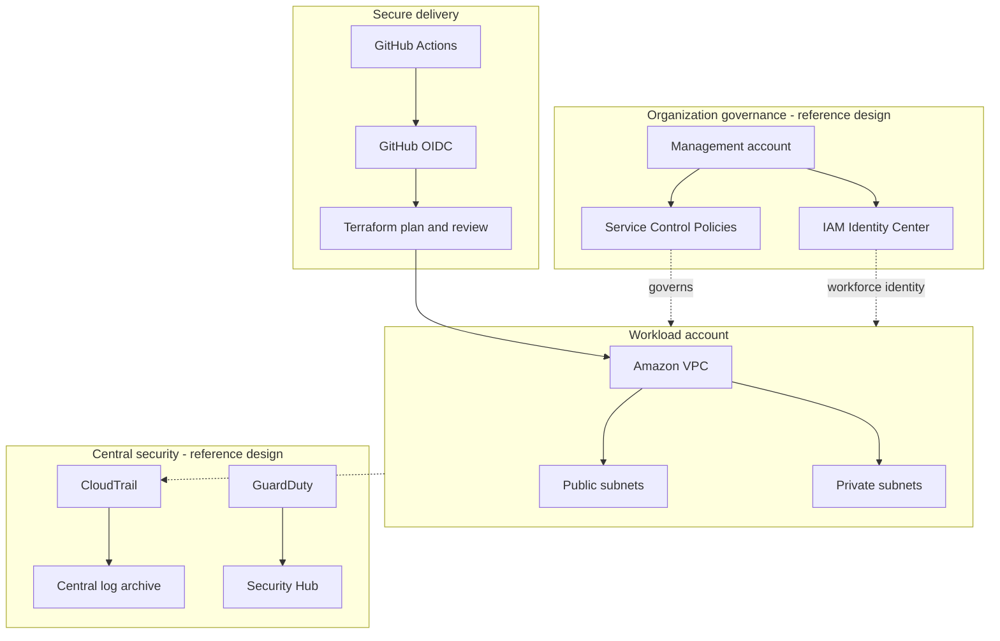
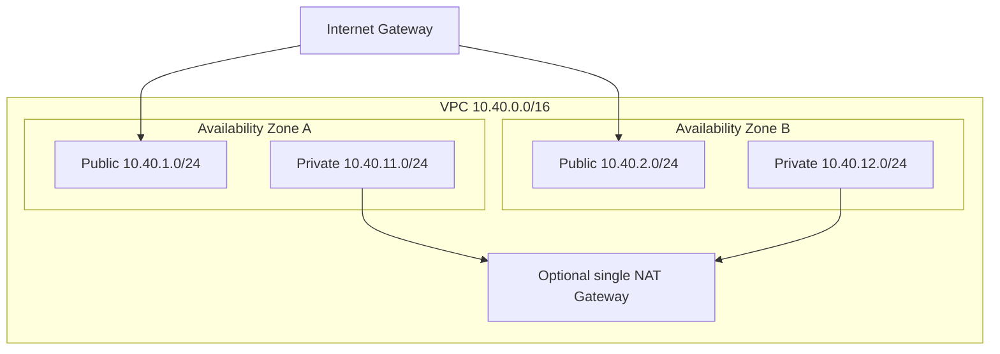

<div align="center">


### Multi-account patterns · Network foundations · Identity · Audit

[](https://aws.amazon.com/)
[](https://developer.hashicorp.com/terraform)
[](https://docs.github.com/actions)
[](https://docs.aws.amazon.com/security/)

**A practical AWS cloud-governance lab covering a Terraform VPC foundation, identity federation examples, organization guardrails, security visibility and operational runbooks.**

[Enterprise architecture](#-enterprise-reference-architecture) · [VPC lab](#-terraform-network-foundation) · [Quick start](#-quick-start) · [Runbooks](docs/runbooks/)

</div>

> [!IMPORTANT]
> **Scope boundary:** the current Terraform root implements a single-account VPC foundation. AWS Organizations, Control Tower, organization CloudTrail, delegated security administration, Security Hub and GuardDuty are reference patterns/examples — not deployed by this root module. Optional NAT and Flow Logs are disabled by default.

## Enterprise reference architecture



The diagram shows an enterprise target-state pattern. It is not evidence that an AWS Organization or central security account has been provisioned.

## Terraform network foundation

The lab VPC uses the address range `10.40.0.0/16` with public and private subnets across two Availability Zones.



The optional single NAT Gateway is a cost-saving lab choice, not a highly available production egress pattern. Optional VPC Flow Logs are also disabled by default.

## What is included

| Capability | Current scope |
|---|---|
| Network foundation | Terraform VPC, two-AZ public/private subnets, route tables and Internet Gateway |
| Egress | Optional single NAT Gateway |
| Network visibility | Optional VPC Flow Logs to CloudWatch Logs with configurable retention |
| CI | Terraform fmt/init/validate, TFLint, Checkov and example JSON validation |
| Governance examples | SCP guardrail samples and GitHub OIDC trust template |
| Operations | Audit, access, incident response, drift and recovery runbooks |
| Interview preparation | Senior Q&A and production incident scenarios |

## Quick start — credential-free validation

Requirements: Terraform 1.6+, AWS CLI v2 and Git.

```bash
git clone https://github.com/haqueamir70-coder/aws-enterprise-cloud-governance-security-platform.git
cd aws-enterprise-cloud-governance-security-platform
terraform -chdir=terraform fmt -check -recursive
terraform -chdir=terraform init -backend=false
terraform -chdir=terraform validate
```

These commands do not create AWS resources. CI runs the baseline checks plus lint and static security scanning.

## Optional sandbox deployment

Read the [deployment guide](docs/deployment/README.md) first. Confirm account identity and estimate cost:

```bash
aws sts get-caller-identity
terraform -chdir=terraform plan -out=tfplan
terraform -chdir=terraform show tfplan
```

Apply only after reviewing and approving the plan:

```bash
terraform -chdir=terraform apply tfplan
```

NAT Gateway, CloudWatch Logs and other enabled services can incur charges. Destroy lab resources after testing and verify no billable resources remain.

## Governance and security principles

- OIDC federation instead of long-lived AWS access keys.
- Separate workload, provisioning and audit identities.
- SCPs define maximum permissions; they do not grant permissions.
- Test SCPs in a non-production OU and preserve a break-glass recovery path.
- Restrict remote Terraform state and enable locking.
- Centralize audit data with retention and access controls in a real multi-account rollout.
- Review region, quotas, egress paths and cost before applying.

## Repository map

```text
.github/workflows/      Terraform and policy CI
terraform/              Single-account VPC foundation
policies/               SCP and OIDC examples
docs/architecture/      Account model and trust boundaries
docs/deployment/         Safe deployment and teardown
docs/security/           Control catalogue and validation matrix
docs/runbooks/           Operational procedures
docs/interview/          Senior Q&A and production scenarios
```

## Validation evidence

A green Terraform CI run validates the configured static checks. It does not prove that Organizations, Control Tower, GuardDuty, Security Hub or centralized logging are deployed. See [delivery status](docs/DELIVERY-STATUS.md) and [Actions](../../actions).

## Senior interview preparation

Start with [interview index](docs/interview/README.md), then work through [advanced production scenarios](docs/interview/advanced-production-scenarios.md). Explain containment, evidence, diagnosis, recovery and prevention — not just service definitions.

## Contributing and license

See [CONTRIBUTING.md](CONTRIBUTING.md). MIT license: [LICENSE](LICENSE).

## Maintainer

**MD Amirul Haque** · [GitHub](https://github.com/haqueamir70-coder) · [LinkedIn](https://www.linkedin.com/in/md-amirul-haque/)

<sub>Govern cloud access. Segment network trust. Preserve audit evidence.</sub>
