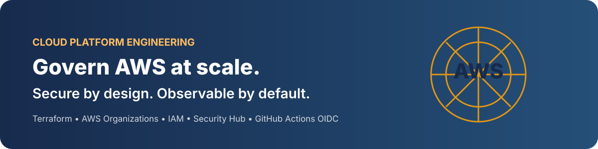

# AWS Enterprise Cloud Governance & Security Platform

<p align="center"></p>

<p align="center">
  
  
  
  
  
</p>

> A practical reference implementation for governing AWS workloads with repeatable infrastructure, identity controls, centralized security visibility, policy checks and operational runbooks.

## Why this project exists
As AWS environments grow from one account to many, teams can lose consistency across identity, network boundaries, audit trails, security detections and delivery pipelines. This repository demonstrates a platform baseline that makes those controls visible, reviewable and automatable.

**Audience:** Cloud Platform Engineers, Senior DevOps / DevSecOps Engineers, Cloud Security Engineers and SREs.

## Platform at a glance

| Capability | Design / implementation |
|---|---|
| Network foundation | Terraform VPC, public/private subnet tiers, route tables, optional NAT |
| Identity | IAM least privilege, GitHub Actions OIDC trust, Identity Center operating model |
| Governance | Organizations / Control Tower model, example SCP guardrails |
| Detection | GuardDuty, Security Hub, AWS Config and CloudTrail integration guidance |
| Audit | Centralized encrypted log archive pattern |
| Delivery | GitHub Actions validation, TFLint and Checkov |
| Operations | Incident, access, drift and recovery runbooks |
| Learning | 50+ senior Q&A and system-design scenarios |

## Architecture

<p align="center"></p>

The SVG uses moving dashed paths to show telemetry and deployment flow. It respects reduced-motion preferences. Read the [architecture guide](docs/architecture/README.md).

## Quick start — safe local validation

Prerequisites: Terraform 1.6+, AWS CLI v2 and Git.

```bash
git clone https://github.com/haqueamir70-coder/aws-enterprise-cloud-governance-security-platform.git
cd aws-enterprise-cloud-governance-security-platform
terraform -chdir=terraform fmt -check -recursive
terraform -chdir=terraform init -backend=false
terraform -chdir=terraform validate
```

These commands validate configuration without creating AWS resources.

For a real sandbox deployment, read the [deployment guide](docs/deployment/README.md), confirm account identity and costs, then plan:

```bash
aws sts get-caller-identity
terraform -chdir=terraform plan -out=tfplan
terraform -chdir=terraform show tfplan
# Apply only after reviewing and approving the plan:
terraform -chdir=terraform apply tfplan
```

## Repository map

```text
.github/workflows/      CI quality gates
docs/architecture/      Account model, trust boundaries and flows
docs/assets/            Vector diagrams (one animated)
docs/deployment/        Safe deployment and teardown
docs/interview/         Senior-level Q&A and design scenarios
docs/runbooks/          Operational procedures
docs/security/          Control catalogue
policies/               SCP and OIDC examples
terraform/              Deployable single-account network baseline
```

## Important scope boundaries
- **Lab-ready foundation:** VPC baseline is code, not a claim of production deployment.
- **Multi-account governance:** Organizations, Control Tower, centralized logging and delegated security administration are documented target patterns with sample policies. They require an appropriately controlled AWS Organization and elevated organization permissions.
- **No credentials in Git:** use short-lived credentials and OIDC. Never commit access keys, state, plan files or secrets.
- **Cost control:** NAT, interface endpoints, Config evaluations, Security Hub, GuardDuty and log ingestion can incur charges. Review cost before deployment and destroy lab resources after testing.
- **SCP caution:** SCPs set maximum permissions; they do not grant permissions. Test in a non-production OU and preserve break-glass recovery.

See [delivery status](docs/DELIVERY-STATUS.md) to distinguish implemented code from organization-level items not deployed here.

## Engineering quality gates
The workflow checks formatting, Terraform validation, lint and static security configuration. A green CI run does **not** prove a live AWS deployment or replace peer review and runtime verification.

## Learning path
1. Read [architecture](docs/architecture/README.md).
2. Validate Terraform locally.
3. Review [security controls](docs/security/README.md).
4. Follow [deployment guide](docs/deployment/README.md).
5. Practice [senior interview Q&A](docs/interview/README.md).
6. Run an incident tabletop using [runbooks](docs/runbooks/README.md).

## Interview discussion prompts
- How do you prevent a compromised workload account from disabling organization-wide audit?
- How do you grant GitHub Actions access without long-lived AWS keys?
- How do you roll out an SCP across 30 accounts without locking out operators?
- How would you connect VPCs and on-premises networks privately?
- How do you prevent Terraform from silently replacing a critical resource?

## Contributing
Use small pull requests, include test output where practical, explain security impact and update documentation. See [CONTRIBUTING.md](CONTRIBUTING.md).

## License
MIT. See [LICENSE](LICENSE).
