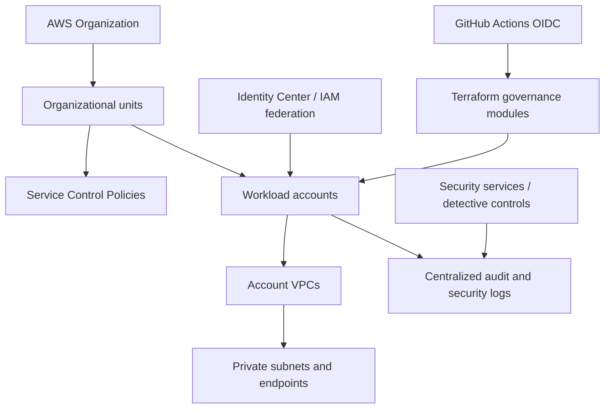

# AWS enterprise cloud governance and security — Architecture & Interview Guide

Reference AWS governance flow across accounts, identity, network, policy, logging and workload delivery. Organization-wide controls are architectural patterns unless deployment evidence exists.

## Architecture diagram

## Interview questions

1. 1. How do AWS Organizations and organizational units support governance?
2. 2. What is the difference between SCPs and IAM policies?
3. 3. How do you design multi-account network isolation?
4. 4. Why use IAM roles with GitHub OIDC instead of static access keys?
5. 5. How do you centralize CloudTrail and security findings?
6. 6. What is the role of AWS Config and Security Hub?
7. 7. How do you enforce encryption and public-access restrictions at scale?
8. 8. How do you structure Terraform state across multiple accounts?
9. 9. How do you test governance policies before rollout?
10. 10. Which organization-level capabilities require AWS Organizations and cannot be proven by a standalone Terraform validate?

## Interview preparation note
For every answer, explain the architecture, trust boundary, failure mode, telemetry, cost implication and validation evidence. Distinguish implemented, CI-validated, cloud-deployed and planned capabilities.
