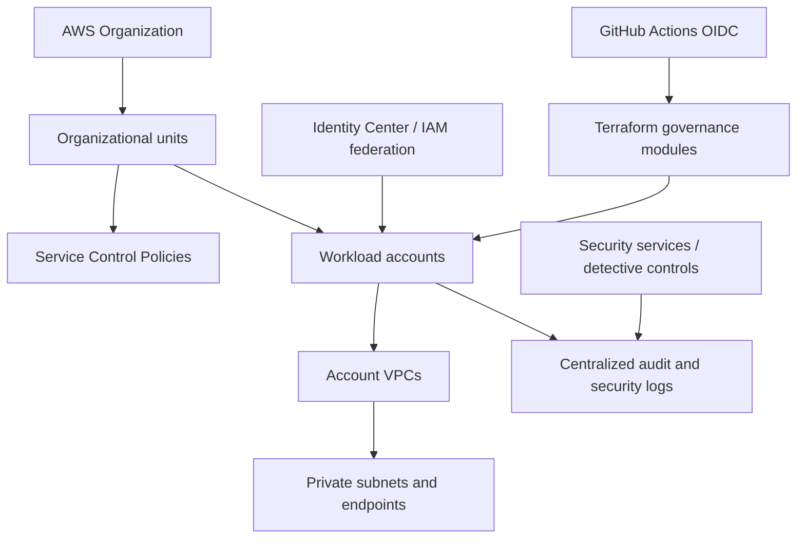

# AWS enterprise cloud governance and security — Architecture & Interview Guide

Reference AWS governance flow across accounts, identity, network, policy, logging and workload delivery. Organization-wide controls are architectural patterns unless deployment evidence exists.

## Architecture diagram

## Interview questions

1. 1. How do AWS Organizations and organizational units support governance?
2. 2. What is the difference between SCPs and IAM policies?
3. 3. How do you design multi-account network isolation?
4. 4. Why use IAM roles with GitHub OIDC instead of static access keys?
5. 5. How do you centralize CloudTrail and security findings?
6. 6. What is the role of AWS Config and Security Hub?
7. 7. How do you enforce encryption and public-access restrictions at scale?
8. 8. How do you structure Terraform state across multiple accounts?
9. 9. How do you test governance policies before rollout?
10. 10. Which organization-level capabilities require AWS Organizations and cannot be proven by a standalone Terraform validate?

## Interview preparation note
For every answer, explain the architecture, trust boundary, failure mode, telemetry, cost implication and validation evidence. Distinguish implemented, CI-validated, cloud-deployed and planned capabilities.

## Interview questions — suggested answers

### 1. Answer

AWS Organizations groups accounts into organizational units and supports consolidated governance, billing and policy boundaries across an enterprise.

### 2. Answer

SCPs set maximum permissions available to principals in member accounts; IAM policies grant permissions within those boundaries. An SCP does not grant access by itself.

### 3. Answer

Use separate accounts for workloads/environments, controlled ingress/egress, shared network services, private subnets and explicit routing/inspection between trust zones.

### 4. Answer

GitHub OIDC lets workflows assume a scoped IAM role with short-lived credentials. Restrict trust to repository/ref/environment and grant only required actions.

### 5. Answer

Centralize CloudTrail organization trails and protected log storage; aggregate AWS Config, GuardDuty and Security Hub findings into a security account.

### 6. Answer

AWS Config records resource configuration and evaluates compliance; Security Hub aggregates security posture findings from AWS services and partner tools.

### 7. Answer

Use policy controls for encryption and public access, account baselines, least-privilege IAM and continuous config/security detection. Test controls before broad enforcement.

### 8. Answer

Use separate state per account/environment or platform layer, remote encrypted S3 state with locking mechanism, versioning and tightly scoped role access.

### 9. Answer

Test SCPs and config rules in a sandbox/OU, use audit-first rollout, validate allowed and denied actions and document break-glass procedures.

### 10. Answer

Organization-wide services require organization setup, delegated administration, permissions and account coverage. A standalone Terraform validation cannot prove those services are active.

## Complete zero-to-hero guide

See [ZERO-TO-HERO.md](./ZERO-TO-HERO.md) for the business scenario, architecture walkthrough, tool-by-tool explanations, implementation sequence, practical commands, troubleshooting playbook and additional scenario-based interview questions with answers.
