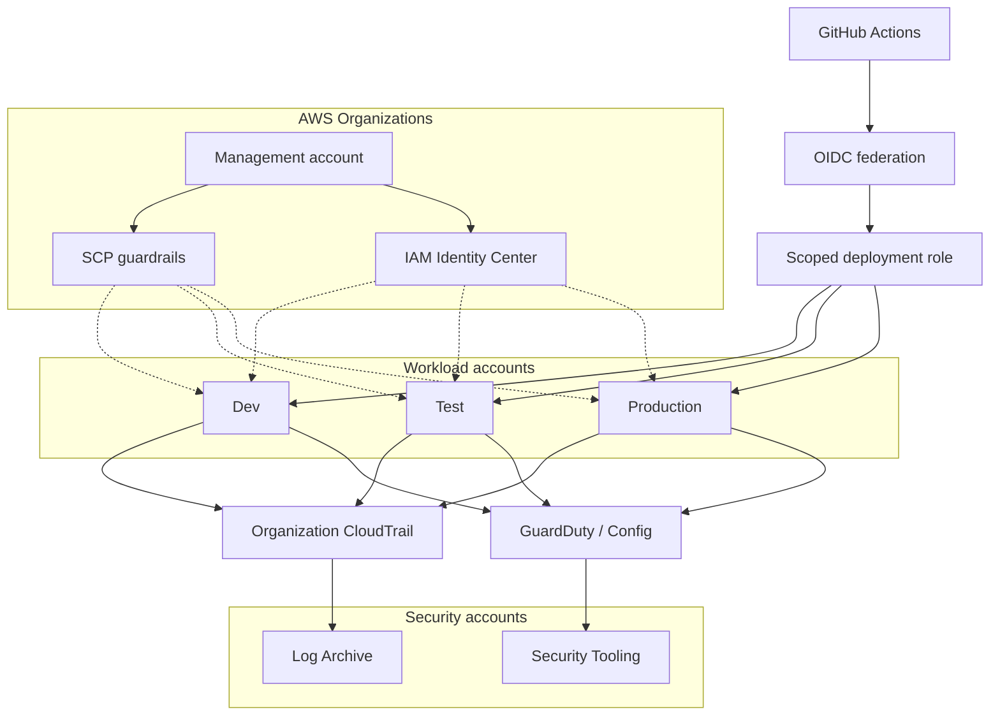
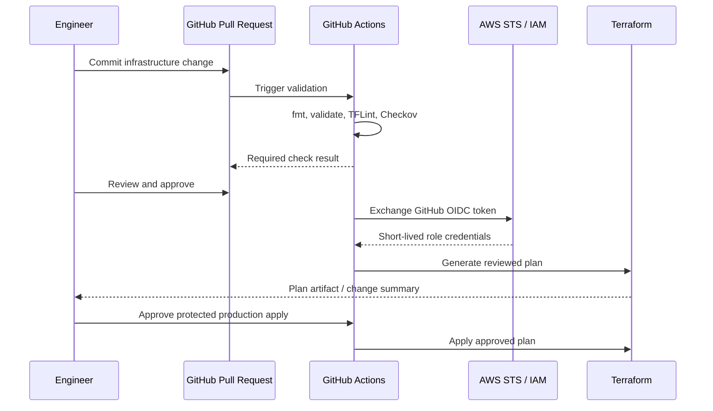
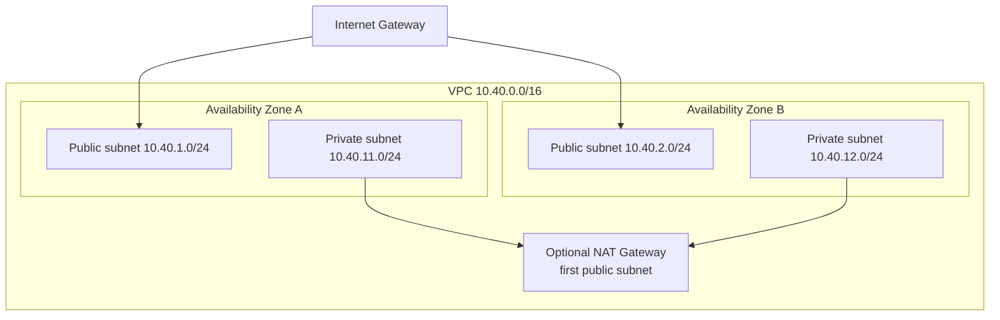

# Architecture Diagrams

GitHub renders Mermaid diagrams directly in Markdown. The diagrams below are the canonical repository views; they are intentionally not dependent on external image hosting.

## Multi-account governance and security

## Secure deployment flow

## VPC lab topology

The current lab uses one optional NAT Gateway, disabled by default. For production, evaluate one NAT per AZ or centralized egress through a network account, depending on resilience and cost requirements.

## Diagram scope

- The organization and central-security views are reference architecture.
- The VPC diagram reflects the current Terraform lab defaults.
- These diagrams do not imply that AWS resources have been deployed.
